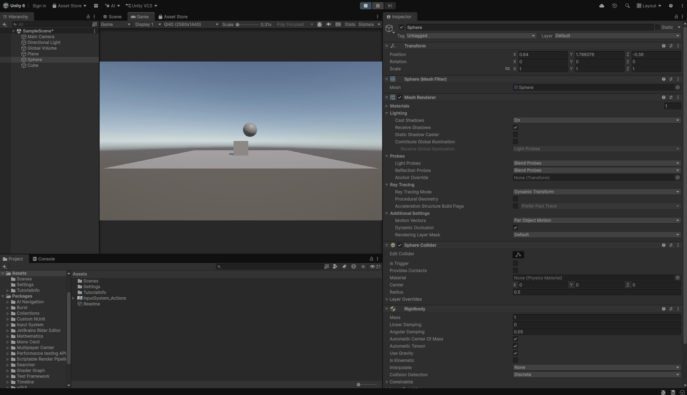
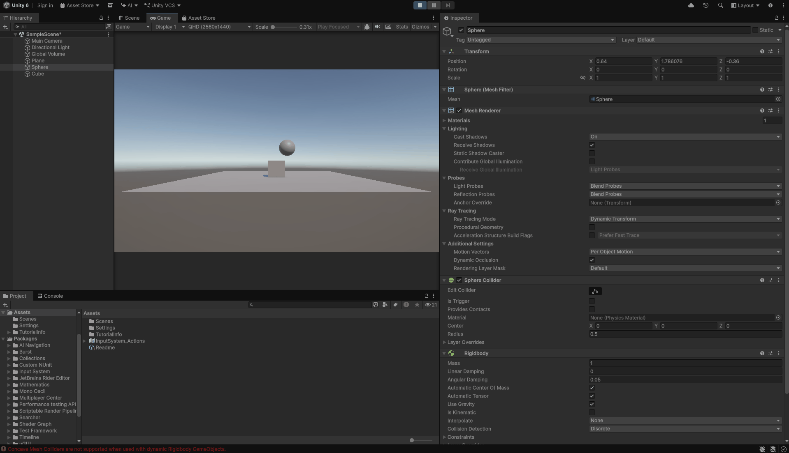
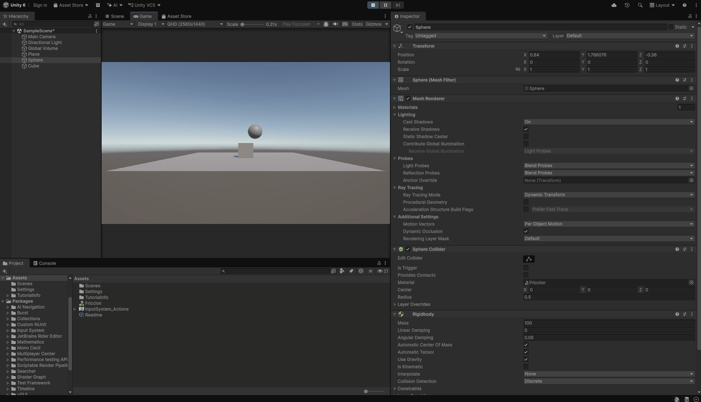
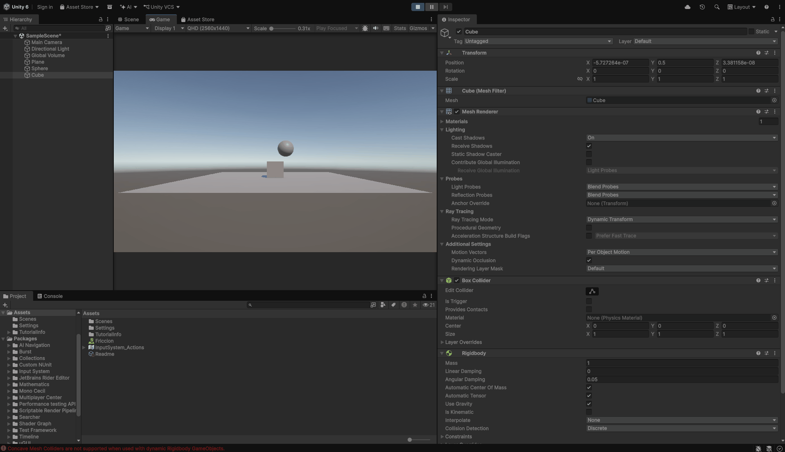
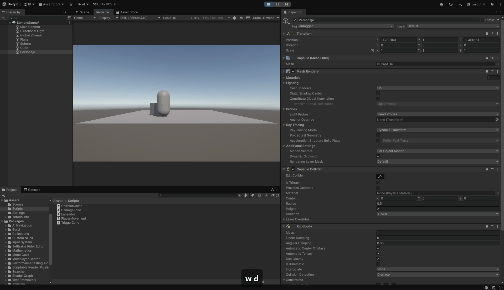
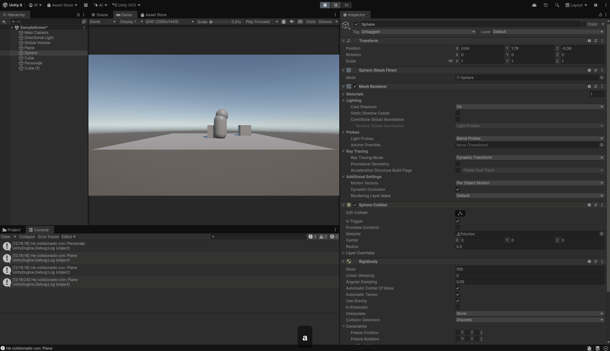
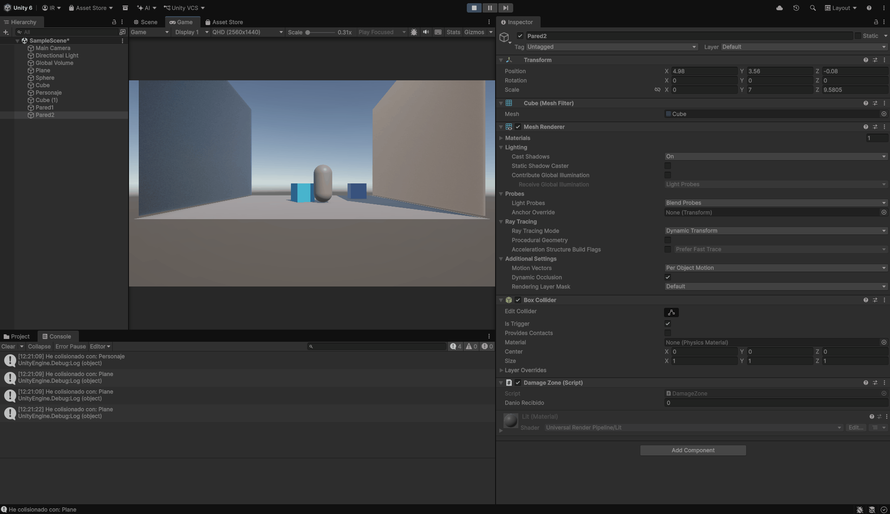
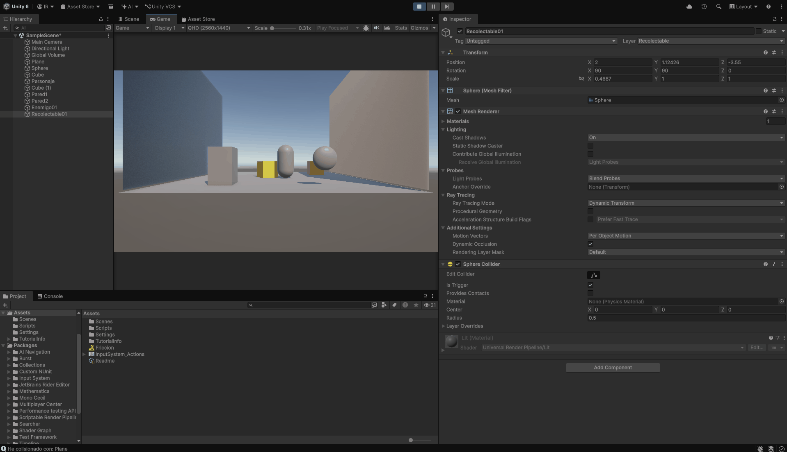
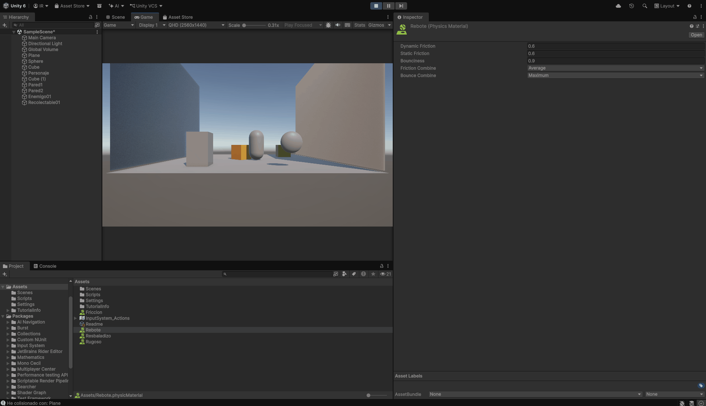
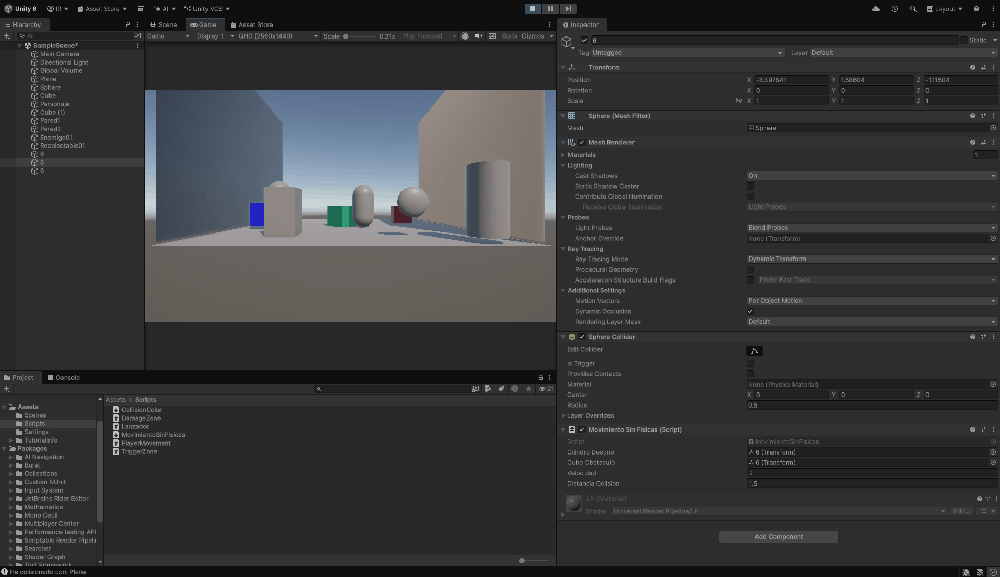

# Práctica: Ejercicio Físicas 3D en Unity

## Descripción

Esta práctica completa de Unity 3D se divide en dos grandes bloques: la experimentación con propiedades físicas básicas (gravedad, masa, fricción, cinemáticas y triggers) y la programación de comportamientos mediante scripts orientados al movimiento, detección de colisiones, zonas de activación, matrices de capas, materiales físicos y lógica sin cuerpos rígidos.

---

## Parte 1: Experimentos de Físicas 3D (Situaciones 1 - 9)

### Situación 1
* **Configuración:** Plano (solo Collider), Cubo (Collider + Rigidbody), Esfera (solo Collider).
* **Resultado:** La esfera se mantiene flotando porque carece de `Rigidbody`. El cubo cae y reposa sobre el plano.
* **Prueba de ejecución:** 

### Situación 2
* **Configuración:** Plano (solo Collider), Cubo (Collider + Rigidbody), Esfera (Collider + Rigidbody).
* **Resultado:** Ambos objetos caen afectados por la gravedad y colisionan de forma realista.
* **Prueba de ejecución:** 

### Situación 3
* **Configuración:** Plano (solo Collider), Cubo (Collider + Rigidbody), Esfera (Collider + Rigidbody Cinemático).
* **Resultado:** La esfera se queda suspendida en el aire al activar `Is Kinematic`, ignorando la gravedad pero manteniendo sus colisiones.
* **Prueba de ejecución:** 

### Situación 4
* **Configuración:** Plano (Collider + Rigidbody), Cubo (Collider + Rigidbody), Esfera (Collider + Rigidbody).
* **Resultado:** Al tener el plano un Rigidbody dinámico, todos los elementos caen conjuntamente hacia el vacío.
* **Prueba de ejecución:** 

### Situación 5
* **Configuración:** Plano (Cinemático), Cubo (Masa: 1), Esfera (Masa: 10).
* **Resultado:** La esfera, al poseer mayor masa, desplaza con gran fuerza al cubo tras el impacto.
* **Prueba de ejecución:** 

### Situación 6
* **Configuración:** Plano (Cinemático), Cubo (Masa: 1), Esfera (Masa: 100).
* **Resultado:** Con una diferencia de masa extrema, la esfera atraviesa y empuja al cubo de forma violenta sin perder inercia.
* **Prueba de ejecución:** 

### Situación 7
* **Configuración:** Plano (Rigidbody), Cubo (Rigidbody), Esfera (Rigidbody + Physic Material de fricción).
* **Resultado:** Al caer todos al unísono desde el mismo instante, no hay movimiento relativo en el eje de caída y el material de fricción no llega a activarse.
* **Prueba de ejecución:** 

### Situación 8
* **Configuración:** Plano (Cinemático), Cubo (Rigidbody), Esfera (Collider [Trigger] + Kinematic).
* **Resultado:** La esfera actúa como área invisible estática (Trigger) sin interactuar físicamente con el entorno.
* **Prueba de ejecución:** 

### Situación 9
* **Configuración:** Plano (Cinemático), Cubo (Rigidbody), Esfera (Collider [Trigger] + Rigidbody dinámico).
* **Resultado:** La esfera cae por gravedad pero, al ser Trigger, atraviesa el cubo y el plano como un fantasma.
* **Prueba de ejecución:** 

---

## Parte 2: Scripting y Comportamientos (Ejercicios 1 - 6)

### Ejercicio 1: Movimiento del Personaje
* **Script:** `PlayerMovement.cs`
* **Descripción:** Control de desplazamiento mediante las teclas WASD o flechas aplicando movimiento directo sobre un `Rigidbody` manteniendo el control total.
* **Prueba de ejecución:** 

### Ejercicio 2: Colisiones y Cambio de Color
* **Script:** `CollisionColor.cs`
* **Descripción:** Detección de impactos en objetos dinámicos mediante `OnCollisionEnter`, mostrando información por consola y alterando su color de material de forma aleatoria.
* **Prueba de ejecución:** 

### Ejercicio 3: Zonas Trigger y Daño
* **Scripts:** `TriggerZone.cs` y `DamageZone.cs`
* **Descripción:** Implementación de áreas de activación que modifican el color del personaje al entrar y salir, junto con zonas de conteo de daño registradas en consola.
* **Prueba de ejecución:** 

### Ejercicio 4: Capas y Matriz de Colisiones
* **Configuración:** Capas `Jugador`, `Enemigo` y `Recolectable` configuradas en la *Layer Collision Matrix*.
* **Descripción:** Aislamiento de colisiones físicas para que los enemigos solo interactúen con el jugador y los coleccionables actúen exclusivamente como triggers detectables.
* **Prueba de ejecución:** 

### Ejercicio 5: Materiales Físicos y Fuerzas
* **Script:** `Lanzador.cs` (Aplicación con tecla **X**)
* **Descripción:** Experimentación con `Physic Materials` (resbaladizo, rugoso, rebote alto) combinados con fuerzas de impulso aplicadas mediante `AddForce()`.
* **Prueba de ejecución:** 

### Ejercicio 6: Desplazamiento sin Rigidbody
* **Script:** `MovimientoSinFisicas.cs`
* **Descripción:** Desplazamiento matemático de una esfera hacia un cilindro objetivo evaluando distancias de proximidad para simular eventos de impacto y alteración de materiales sobre obstáculos sin necesidad de cuerpos físicos.
* **Prueba de ejecución:** 